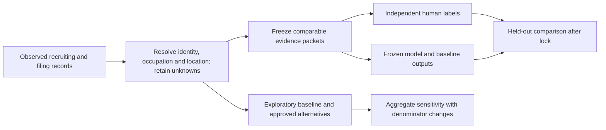

# AI Jobs Map: Measuring What Boston-Area Organizations Signal About AI in Hiring

*Rough methods manuscript for author review. No firm ratings, model comparisons, sensitivity results, or new findings are disclosed. This is not a preregistration or an operational hiring guide.*

## Abstract

Organizations can develop AI systems, integrate them into other products, or use them in ordinary workflows. Advertisements may describe any of these activities, or make generic claims that do not support any of them. The AI Jobs Map links observable hiring signals to firm and occupation records and registers the analytical decisions that determine what the map displays. We describe two related studies: comparison of classification methods against independently coded firm evidence and an exploratory audit of how analytic choices change aggregate descriptions. The work is designed to keep posting evidence separate from visa filing evidence, uncertainty separate from an absence of AI activity, and exploratory branch behavior separate from confirmatory model evaluation. The database build, review procedures, and branch infrastructure provide a basis for the design; estimated performance awaits the locked evaluation.

## Introduction

A job advertisement is a signal of stated recruiting demand, not a record of filled jobs or of what workers do. Organizations that describe AI in a job posting can do very different things: a role may build models or infrastructure, integrate AI services into another system, or use a tool inside a wider workflow. A paragraph describing company aspirations does not prove that the role does any of those things. The distinction matters in geographically bounded maps, where the apparent composition can depend on whether Boston means employer location or place of work, what employers a board captures, and what text survives parsing.

Two questions organize the paper. **Measurement:** how closely do reproducible rule-based and model-based systems recover human interpretations of an identical firm evidence packet? **Robustness:** which aggregate descriptions from the exploratory map stay stable under defensible changes in its construction? These questions have different endpoints and should not share a tuning loop. [CITATION NEEDED: research on employer-board coverage, firm-level AI measurement and multiverse methods, verified against primary sources before submission.]

## Data and measurement design

The pipeline combines employer-board ads, LCA filing information and an O*NET/SOC title crosswalk; see the [project documentation](../README.md) and [public analytic decision registry](multiverse/decision_points.yaml). The captured corpus defines the set of available records. Normalize employer identity and location strings under recorded rules, retain unmatched and uncertain joins, and distinguish event time from collection time. Maintain separate accounting for duplicate listings and observed role identities. A role key is a construct and can merge similar requisitions or split a repost. The text-role inventory can use a different unit if requirement-text variation distinguishes records; any table crossing these views must identify both denominators. [NEEDS: dated and rights-cleared source manifest, fixed geography, handling of remote and unknown locations, and an accounting of extraction and join failures.]

| Evidence layer | Supports | Does not establish |
|---|---|---|
| Role text and recruiting metadata | Stated duties, tools or preferences in captured listings | Hiring completed, actual tasks, company-wide adoption |
| Title-to-occupation crosswalk | Occupational grouping for mapped titles | Correct class for every ad or known occupations for unmapped titles |
| LCA filing match | A matching filing under the specified identity rule and period | A worker hired, currently sponsored, or an employer's future sponsorship policy |
| Firm packet | Interpretation supported by the material provided to a reviewer | A complete audit of the firm or facts outside the packet |

Record Boston-area membership independently of firm identity. An employer with an area connection is not proof that every advertised position is local. Record known worksite, ambiguous remote location and unknown worksite in separate categories. Report how employer and role coverage move under a worksite rule before using local scope in a claim. Externally supplied text is evidence, not executable instructions, and not all source material may be redistributed.

## Part I: classification against human judgments

Use the [contributor guide](CONTRIBUTING-paper.md) as the governance source. Human raters independently assess the same frozen packets, without AI assistance and without seeing model outputs or comparisons until their ratings are complete. Freeze the codebook after the pilot and preserve pre-adjudication ratings with an explicit insufficient-evidence option. Report agreement before treating adjudication as a reference; consensus is not independent proof of the firm's real-world activity.

Compare the proposed co-occurrence baseline and model classifiers on the same evaluation units and evidence views, without tuning against held-out ratings. Log packet versions, model and prompt versions, parsing and abstention policies, and any invalid outputs. [ASSUMPTION: Split by firm or related firm family, subject to the final protocol, to reduce leakage from recurring template language.] If tasks allow multiple classifications per firm, do not force mutually exclusive outcomes merely to simplify evaluation. Report performance by class and coverage, showing how results change when insufficient-evidence cases are retained rather than hidden. If confidence scores are obtained, define the event each score predicts, calibrate on disjoint evidence, and report confidence reliability on the held-out set. Audit whether cited spans support the assigned interpretation rather than merely containing an AI-associated word. [NEEDS: signed-off class definitions, split and sample size; primary metric and uncertainty analysis; confirmatory protocol status.]

## Part II: exploratory multiverse

A recorded default specifies identity matching, role counting, text eligibility, scoring, support thresholds, geography, aggregation and other decisions. A contributor can nominate defensible alternatives for an open decision point. Record the rationale and expected direction before running. Compare each accepted branch with a fresh baseline at the same code revision and unchanged source snapshots. Preserve excluded alternatives and their reasons; an outcome in a branch is not a reason to erase it. Report differences in both population and output; some branches change who is measurable, not just the measurement among common firms. If testing joint interactions, prerecord coherent combinations and explain which individual contrasts cannot isolate a joint change. Never run exploratory changes against the separate locked test. [NEEDS: branch inventory, approved change sets, exact reproducibility steps, and release clearance for output summaries.]

## Results status, figures and interpretation

No results are reported in this public drafting copy, which is intentionally safe to hand to a reader who must remain blind. A final report after clearance should include a coverage-flow table; unadjudicated agreement; held-out classification, abstention and calibration; and branch-level changes with population counts. [NEEDS: governed release of audited results after rating is complete.] The main flow figure below shows design, not data.

**Figure 1.** Two evaluation paths share data-construction provenance. Exploratory alternatives cannot tune or rerun the locked human comparison.

## Discussion

If human judges disagree, differences between model accuracy and the adjudicated reference will need to be interpreted relative to the disagreements, not hidden by a single aggregate number. If shifting the worksite definition or minimum evidence changes the aggregate composition, public views should show that dependence rather than advertise a single firm ordering as fact. Conversely, stable results across chosen alternatives would support robustness to those choices in this corpus, not representativeness beyond it. Open coverage gaps include organizations absent from the boards, variation in posting templates, uncertain identities and geography, and limited evidence about jobs not advertised or not mapped. The intended contribution is a transparent, revisable map of observed evidence, with release boundaries for data that cannot be redistributed. Do not use the map to infer individual employment, eligibility, or visa outcomes.
